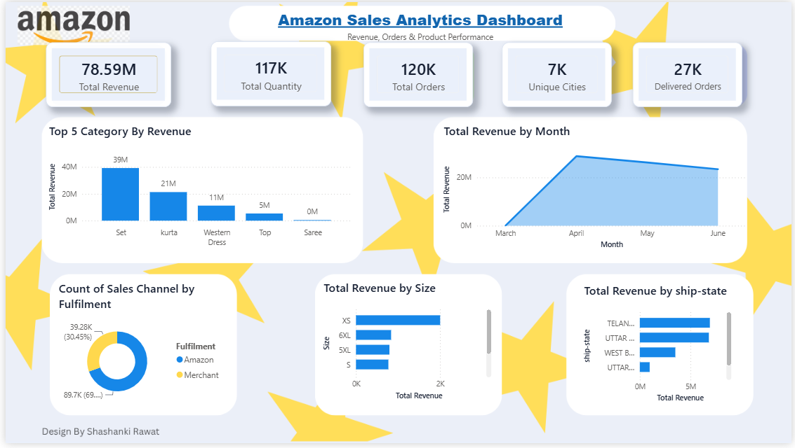

# Amazon Sales Analytics Dashboard

An end-to-end data analytics project using **Python (Pandas), SQL Server, and Power BI** to clean, analyze, and visualize Amazon sales data.

## 📊 Dashboard Preview



## 📌 Project Overview

This project analyzes Amazon sales data to understand revenue trends, product category performance, order volumes, fulfilment channels, and shipping-region patterns.

The project combines Python-based data cleaning, SQL queries, and an interactive Power BI dashboard to turn raw sales data into meaningful business insights.

## 🛠️ Tools & Technologies

- **Python:** Pandas, NumPy
- **Database:** Microsoft SQL Server, SSMS
- **Data Visualization:** Microsoft Power BI
- **Data Format:** CSV
- **Version Control:** Git and GitHub

## 📈 Dashboard Highlights

The dashboard includes the following KPIs and visualizations:

- **Total Revenue:** Sum of the `Amount` column
- **Total Quantity:** Total quantity ordered
- **Total Orders:** Distinct order count
- **Unique Cities:** Number of distinct shipping cities
- **Delivered Orders:** Distinct orders classified as delivered
- Top 5 product categories by revenue
- Monthly revenue trends
- Fulfilment channel distribution
- Revenue by product size
- Revenue by shipping state

## 🧹 Data Cleaning with Pandas

The dataset was inspected and cleaned using Pandas.

Key steps included:

- Examining dataset dimensions and data types
- Identifying missing and blank values
- Standardizing column names and text values
- Converting dates and numeric columns
- Checking duplicate records
- Investigating invalid or suspicious quantities and amounts
- Exporting the cleaned dataset and data-quality reports

Missing values and suspicious records were reviewed rather than automatically replaced with fabricated values.

## 🗄️ SQL Analysis

SQL Server was used to retrieve, filter, update, and analyze sales data.

The SQL workflow includes:

- Selecting all records and specific columns
- Filtering records using conditions
- Retrieving distinct categories and values
- Investigating missing values and duplicates
- Analyzing sales and order information

## 💡 Business Questions Explored

- Which product categories generate the highest reported sales?
- How does revenue change over time?
- Which fulfilment channel handles the most records?
- Which product sizes contribute most to sales?
- Which shipping states have the highest reported sales?
- What data-quality issues should be investigated before analysis?

## 📁 Project Structure

```text
Amazon-Sales-Report/
├── dashboard/
│   ├── Amazon Sales Dashboard.pbix
│   └── Amazon-Dashboard.png
├── data/
│   ├── Amazon Sale Report(Uncleaned).csv
│   └── Amazon_Sales_Cleaned.csv
├── python/
│   ├── Amazon_Sales_Theme.json
│   └── Data Cleaning (Pandas).py
├── sql/
│   └── SQLQuery1.sql
├── Amazon Logo.png
├── Amazon Dashboard design by Shashanki Rawat.png
└── README.md
```

## 🚀 How to Use This Project

1. Clone or download this repository.
2. Install Python dependencies:

   ```bash
   pip install pandas numpy
   ```

3. Run the Pandas cleaning script with the source CSV in the expected location.
4. Open `SQLQuery1.sql` in SQL Server Management Studio and adjust the table name to match your database.
5. Open `Amazon Sales Dashboard.pbix` in Power BI Desktop.
6. If prompted, update the data source path to your local cleaned CSV.

## 📌 Data Quality Notes

- The original dataset contains **128,975 rows and 21 columns**.
- The initial audit identified **zero exact duplicate rows**.
- Some fields contain missing values that require appropriate handling.
- Date parsing should be verified before drawing conclusions from monthly trends.
- Zero quantities and amounts should be investigated rather than automatically deleted.
- Repeated order IDs do not necessarily indicate duplicates because an order may contain multiple product lines.

## ⚠️ Limitations

- Revenue represents the sum of the source dataset's `Amount` field; it is not profit.
- Unique shipping cities do not represent unique customers.
- Results depend on the quality and completeness of the original dataset.
- Data-quality issues should be reviewed before using the results for business decisions.

## 👩‍💻 Author

**Shashanki Rawat**

Data analytics portfolio project built using Python, SQL Server, and Power BI.
